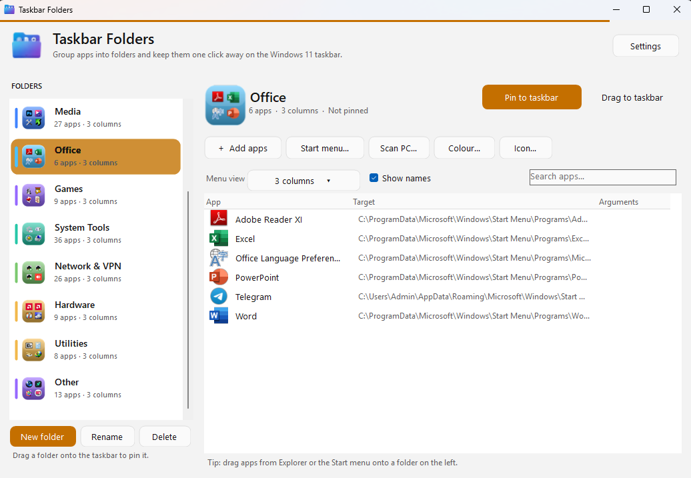
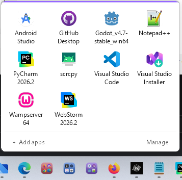

# Taskbar Folders

> Group apps into folders and pin them to the Windows 11 taskbar.  
> Click the pinned icon → a clean acrylic flyout slides up with your apps.

[](https://dotnet.microsoft.com/)
[](https://www.microsoft.com/windows)
[](LICENSE)
[](https://github.com/keyvan-alavi/TaskbarFolders/releases)

---

### Why this exists?

Windows 11 still doesn’t let you create real folders on the taskbar.  
This small tool solves that problem without any background process or tray icon.

---

### Features (v0.1.0-beta)

- Create unlimited folders
- Drag & drop `.exe` and `.lnk` files
- One-time pin to taskbar (manual, because Windows has no public API)
- Windows 11 style acrylic flyout with rounded corners
- Dark / Light theme support (follows system)
- Launch as normal user or as Administrator (right-click or `Shift` + `Enter`)
- Keyboard navigation (Arrow keys, Enter, Esc)
- Almost zero RAM usage when idle (process exits after the menu closes)
- Folder icon is auto-generated as a 2×2 grid of the apps inside

---

### Screenshots

| Manager | Flyout |
|---------|--------|
|  |  |

---

### Requirements

- Windows 11 (recommended 22H2 or newer for acrylic backdrop)
- [.NET 8 Desktop Runtime](https://dotnet.microsoft.com/download/dotnet/8.0) (x64)

---

### How to use

1. Download the latest release from the [Releases](https://github.com/keyvan-alavi/TaskbarFolders/releases) page.
2. Put `TaskbarFolders.exe` in a **permanent** location (e.g. `C:\Tools\TaskbarFolders\`).
3. Run it → create a folder → drag apps into it.
4. Click **Create taskbar shortcut for this folder**.
5. Pin the generated shortcut to the taskbar (right-click → Pin to taskbar).
6. Click the pinned icon anytime to open the flyout.

---

### Build from source

```powershell
git clone https://github.com/keyvan-alavi/TaskbarFolders.git
cd TaskbarFolders
dotnet publish -c Release
```

Output:  
`bin\Release\net8.0-windows\win-x64\publish\TaskbarFolders.exe`

---

### Contact & Support

- Website: [https://technokey.ir](https://technokey.ir)
- Telegram: [https://t.me/Kewin_67](https://t.me/Kewin_67)

Feel free to open issues or send feedback.

---

### License

MIT License – free to use, modify and distribute.
