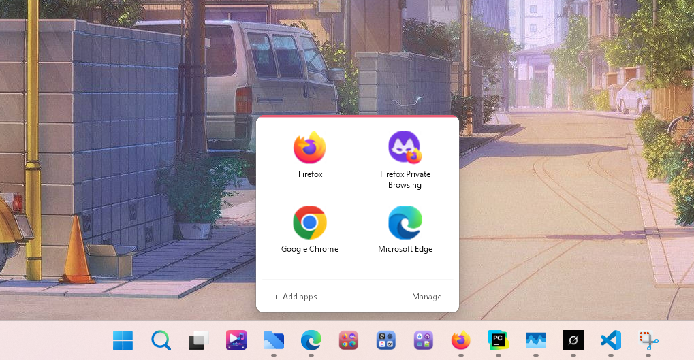
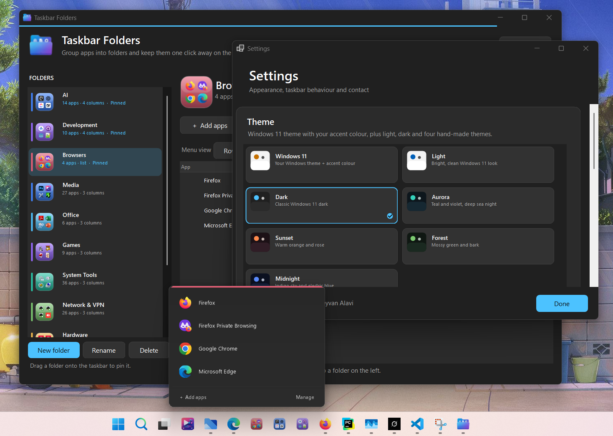

# Taskbar Folders

> Group apps into folders and pin them to the Windows 11 taskbar.  
> Click the pinned icon → a clean themed flyout slides up with your apps.

[](https://dotnet.microsoft.com/)
[](https://www.microsoft.com/windows)
[](LICENSE)
[](https://github.com/keyvan-alavi/TaskbarFolders/releases)

---

### Why this exists?

Windows 11 still doesn’t let you create real folders on the taskbar.  
This small tool solves that problem without any background process or tray icon.

---

### Features

- Create unlimited folders with custom colours and icons
- **Scan this PC** — auto-categorise Start-menu apps and create folders by category
- Add apps from Start menu, drag & drop, or “+ Add apps”
- Flexible layout: 1–4 columns (list or icon grid)
- Themes: Windows 11 (system + accent), Light, Dark, Aurora, Sunset, Forest, Midnight
- Opening animations (Slide, Fade, Zoom…)
- Easy pinning with automatic “Pinned ✓” detection
- Almost zero RAM usage when idle

---

### Screenshots

| Manager | Pin Taskbar |
|---------|---------|
|  |  |

| Flyout Menu | Settings / Themes |
|-------------|-------------------|
|  |  |

---

### Demo Video

> A short overview of the program will be available here.

---

### Requirements

- Windows 11
- [.NET 8 Desktop Runtime](https://dotnet.microsoft.com/download/dotnet/8.0) (x64)

---

### How to use

1. Download `TaskbarFolders.exe` and put it in a **permanent** location (e.g. `C:\Tools\TaskbarFolders\`).
2. Run the program → create a folder or use **Scan PC…** to auto-organise.
3. Add apps (drag & drop, Start menu, Scan, or “+ Add apps”).
4. (Optional) Set colour, icon, layout and animation.
5. Click **Pin to taskbar** (or use Drag to taskbar).
6. Click the pinned icon on the taskbar anytime to open the menu.

---

### Build from source

```powershell
git clone https://github.com/keyvan-alavi/TaskbarFolders.git
cd TaskbarFolders
dotnet publish -c Release
```

Output:  
`bin\Release\net8.0-windows\win-x64\publish\TaskbarFolders.exe`

---

### Contact & Support

- Website: [https://technokey.ir](https://technokey.ir)
- Telegram: [https://t.me/Kewin_67](https://t.me/Kewin_67)
- Email: key1.alavi@gmail.com
- GitHub: [keyvan-alavi](https://github.com/keyvan-alavi)

---

### License

MIT License – free to use, modify and distribute.

Made with ♥ by **Keyvan Alavi**
